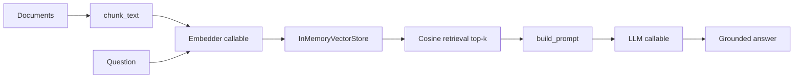

<p align="center">
  
</p>

<h1 align="center">RAG Pipeline</h1>

<p align="center">
  <strong>A Retrieval-Augmented Generation (RAG) pipeline in Python — chunking, vector store, retrieval, and grounded prompt building.</strong><br>
  Ingest a corpus, retrieve the most relevant context, and answer questions with a pluggable LLM.
</p>

<p align="center">
  <em>Built and maintained by <a href="https://viprasol.com">Viprasol Tech</a> — Fintech Experts. Full-Stack Builders.</em>
</p>

<p align="center">
  <a href="https://github.com/Viprasol-Tech/rag-pipeline/actions/workflows/ci.yml"></a>
  <a href="LICENSE"></a>
  
  <a href="https://t.me/viprasol_help"></a>
  <a href="https://github.com/Viprasol-Tech/rag-pipeline/stargazers"></a>
</p>

---

> **Provider-agnostic and offline-capable.** The LLM and embedder are just plain
> Python callables (`Callable[[str], str]` and `Callable[[str], list[float]]`).
> Ship the built-in deterministic **fakes** for tests and demos that run with **no
> network, no API keys, and no heavy SDKs** — then swap in OpenAI,
> sentence-transformers, or any model behind the same interface. The retrieval
> math (real word-based chunking, genuine cosine similarity, grounded prompts) is
> the real thing; only the model call is pluggable.
>
> *Not production-hardened — review and test before relying on it in production.*

---

## Features

- **Word-based chunking** — split text into overlapping windows with exact, configurable size/overlap math.
- **In-memory vector store** — `add(text, embedding)` and `search(query, k)` via genuine cosine similarity, returning top-k hits with scores.
- **Deterministic offline embedder** — a hashed bag-of-words `FakeEmbedder` so the whole pipeline runs without a model download.
- **Pluggable LLM** — pass any `Callable[[str], str]`; a built-in grounded `echo_llm` keeps demos and tests fully offline.
- **Grounded prompt builder** — numbered context blocks + question + `Answer:` cue, ready for any chat model.
- **CLI** — `rag-pipeline demo` ingests a small corpus and answers a question offline.
- **Modern tooling** — ruff, mypy (strict), pytest, GitHub Actions CI.

## Quickstart

```bash
git clone https://github.com/Viprasol-Tech/rag-pipeline.git
cd rag-pipeline
python -m pip install -e ".[dev]"

# Ingest a built-in corpus and answer a question, fully offline:
rag-pipeline demo
rag-pipeline demo --question "What is the powerhouse of the cell?" --top-k 2
```

## Plug in a real provider

The pipeline defaults to the offline fakes. Swap in your own embedder and LLM —
each is just a callable, so there is no framework to learn:

```python
from rag_pipeline import RAGPipeline

# Bring your own model. Any callable with the right shape works.
def my_embedder(text: str) -> list[float]:
    ...  # e.g. OpenAI / sentence-transformers embeddings

def my_llm(prompt: str) -> str:
    ...  # e.g. an OpenAI chat completion

pipeline = RAGPipeline(embedder=my_embedder, llm=my_llm, top_k=3)
pipeline.ingest("Photosynthesis lets plants turn sunlight into glucose.", source="bio")

result = pipeline.answer("How do plants use sunlight?")
print(result.answer)        # the grounded LLM answer
print(result.contexts)      # the retrieved chunks (with scores)
print(result.prompt)        # the exact prompt sent to the LLM
```

Run it with **zero** arguments and it uses the built-in `FakeEmbedder` + `echo_llm` — no network, no keys.

## Architecture



## Roadmap

- [x] Word-based chunking with overlap, in-memory cosine vector store
- [x] Deterministic offline fake embedder + pluggable LLM, grounded prompts
- [x] Typer CLI demo running fully offline
- [ ] Persistent / ANN vector backends (FAISS, pgvector)
- [ ] Streaming (SSE) answer output and citations
- [ ] Reranking and hybrid (keyword + vector) retrieval

## Contributing

PRs welcome — see [CONTRIBUTING.md](CONTRIBUTING.md) and our [Code of Conduct](CODE_OF_CONDUCT.md).

## 📬 Contact — Viprasol Tech Private Limited

- 🌐 Website: [viprasol.com](https://viprasol.com)
- ✉️ Email: [support@viprasol.com](mailto:support@viprasol.com)
- 💬 Telegram: [t.me/viprasol_help](https://t.me/viprasol_help) · 📱 WhatsApp: +91 96336 52112
- 🐙 GitHub: [@Viprasol-Tech](https://github.com/Viprasol-Tech) · 💼 [LinkedIn](https://www.linkedin.com/in/viprasol/) · 𝕏 [@viprasol](https://twitter.com/viprasol)

> *Viprasol Tech — fintech software, algorithmic trading systems, MT4/MT5 bots, AI voice agents, and B2B SaaS. Need a custom build? [Get in touch](mailto:support@viprasol.com).*

## License

[MIT](LICENSE) (c) 2025 Viprasol Tech Private Limited
